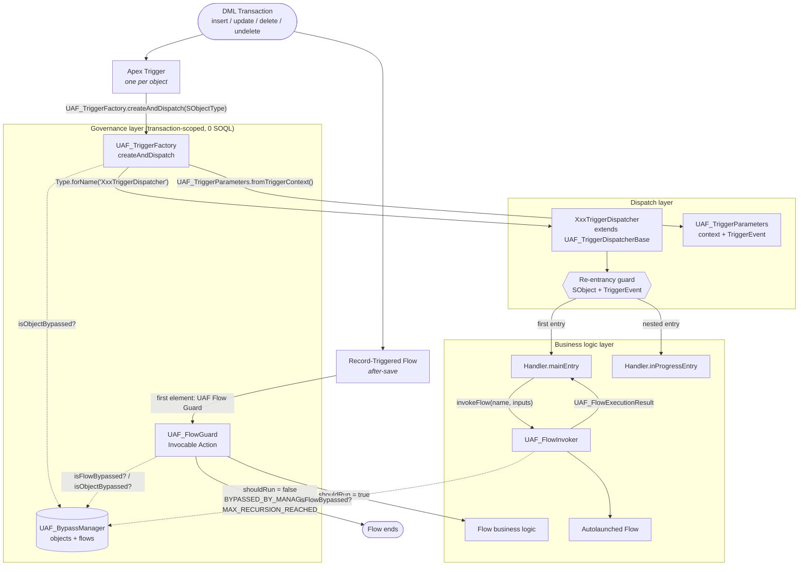

# Unified Automation Framework (UAF)


**One governance model for Apex triggers _and_ Salesforce Flows.**

UAF is a lightweight, dependency-free Salesforce framework that brings the proven
"one trigger per object → factory → dispatcher → handler" architecture to Flows. Execution
order, re-entrancy control and bypasses work the same way whether your automation lives in
Apex, in a Record-Triggered Flow, or in an Autolaunched Flow called from Apex.

<a href="https://githubsfdeploy.herokuapp.com/app/githubdeploy/Kaatelars/uaf-salesforce?ref=main"></a>
<a href="https://githubsfdeploy-sandbox.herokuapp.com/app/githubdeploy/Kaatelars/uaf-salesforce?ref=main"></a>

---

## Table of Contents

- [Why UAF?](#why-uaf)
- [Architecture](#architecture)
- [Quick Start](#quick-start)
- [Usage Guide](#usage-guide)
  - [A. Add a trigger and dispatcher for a new object (3 steps)](#a-add-a-trigger-and-dispatcher-for-a-new-object-3-steps)
  - [B. Govern a Record-Triggered Flow with `UAF_FlowGuard`](#b-govern-a-record-triggered-flow-with-uaf_flowguard)
  - [C. Launch an Autolaunched Flow from an Apex handler with `UAF_FlowInvoker`](#c-launch-an-autolaunched-flow-from-an-apex-handler-with-uaf_flowinvoker)
  - [D. Manage bypasses in unit tests with `UAF_BypassManager`](#d-manage-bypasses-in-unit-tests-with-uaf_bypassmanager)
  - [E. Bypass all automation for Data Loader, SFDMU and ETL users](#e-bypass-all-automation-for-data-loader-sfdmu-and-etl-users)
- [Component Matrix & Governor Limits](#component-matrix--governor-limits)
- [Repository Layout](#repository-layout)
- [Known Limitations](#known-limitations)
- [Roadmap](#roadmap)
- [Contributing](#contributing)
- [License](#license)

---

## Why UAF?

Trigger frameworks such as **Hari Krishnan's** trigger architecture, **Dan Appleman's**
centralized dispatching (_Advanced Apex Programming_) and **Kevin O'Hara's** lightweight
trigger handler solved the classic Apex problems: one trigger per object, predictable
ordering, recursion control and the ability to switch logic off.

They were designed before Flow became the primary declarative automation tool. Today a single
`update` on an Account can run Apex triggers, before-save Flows, after-save Flows and
Autolaunched Flows called from Apex, all in one transaction. Because the trigger framework
only governs Apex, three problems appear:

| Problem | What happens |
|---|---|
| **Order-of-execution conflicts** ("race conditions") | Apex and Flow both write to the same record in the same save cycle. The final value depends on the order the platform runs them in, not on your design. |
| **Cross recursion** | An Apex handler updates a record, which re-fires an after-save Flow, which updates the record again, which re-fires the trigger... Apex recursion guards don't see Flow re-entries, and Flow has no transaction-scoped memory. |
| **Fragmented logic & bypasses** | Disabling automation for a data load means switching off the trigger framework, then deactivating Flows or adding custom permissions to every entry criterion. Every tool needs its own switch. |

UAF extends the trigger-framework pattern to Flows:

- **One bypass registry** (`UAF_BypassManager`) that both Apex dispatching and Flows check.
- **One re-entrancy model**: Apex handlers get `mainEntry` / `inProgressEntry`; Flows get a
  per-record, per-transaction execution limit through `UAF_FlowGuard`.
- **A safe Apex → Flow bridge** (`UAF_FlowInvoker`) so handlers can delegate to Flows without
  losing bypass control or error handling.

---

## Architecture



**Execution sequence for a trigger:** `bulkBefore` / `bulkAfter` → event method
(e.g. `afterUpdate`) → `execute(handler, tp, event)` → `mainEntry` or `inProgressEntry` →
`andFinally`.

---

## Quick Start

### Option 1: one-click deploy (no CLI required)

| Target org | Button | Login endpoint |
|---|---|---|
| Production / Developer Edition | <a href="https://githubsfdeploy.herokuapp.com/app/githubdeploy/Kaatelars/uaf-salesforce?ref=main"></a> | `login.salesforce.com` |
| Sandbox | <a href="https://githubsfdeploy-sandbox.herokuapp.com/app/githubdeploy/Kaatelars/uaf-salesforce?ref=main"></a> | `test.salesforce.com` |

1. Click the button for your org type and log in.
   **Tip:** if your browser already has an active session in another org, Salesforce may reuse
   it. Use a private window, or log out first, to pick the right org.
2. Click **Allow** to grant the deploy tool access, review the components and click **Deploy**.

The buttons deploy **only the framework** (`force-app`, the default package directory). The
reference implementation is not included.

> The buttons use [GitHub Salesforce Deploy](https://github.com/afawcett/githubsfdeploy), an
> open-source community tool by Andrew Fawcett that is not affiliated with this project. It
> asks for OAuth access to your org in order to run a Metadata API deployment. Deployments to
> production run the org's Apex tests, as with any deployment. Try it in a sandbox or Developer
> Edition org first.

### Option 2: Salesforce CLI

**Prerequisites**

- [Salesforce CLI](https://developer.salesforce.com/tools/salesforcecli) (`sf`) v2+
- An org (Developer Edition, sandbox or scratch org) authorized in the CLI

**Install the framework only (`force-app`)**

The repository has two package directories. `force-app` holds the framework.
`reference-app` holds an example Account implementation that you usually **don't** want in
your org. Deploy only `force-app`:

```bash
git clone https://github.com/Kaatelars/uaf-salesforce.git
cd uaf-salesforce

sf org login web --alias my-org                       # if not authorized yet
sf project deploy start --source-dir force-app --target-org my-org
sf apex run test --class-names UAF_Core_Test --class-names UAF_BypassManager_Test --class-names UAF_Flow_Test \
  --code-coverage --result-format human --wait 10 --target-org my-org
```

> `force-app` also contains `UAF_Test_Echo_Flow`, a tiny Autolaunched Flow that `UAF_Flow_Test`
> uses as a fixture. It has no business logic.

**Optional: explore the reference implementation**

```bash
sf project deploy start --target-org my-org          # deploys force-app + reference-app
sf org assign permset --name UAF_Reference_Implementation --target-org my-org
```

`reference-app` adds `AccountTrigger`, `AccountTriggerDispatcher`, two handlers, three `UAF_*__c`
fields on Account, the Record-Triggered Flow `UAF_Account_Guarded_Flow` and the end-to-end test
`Account_UAF_Integration_Test`.

---

## Usage Guide

### A. Add a trigger and dispatcher for a new object (3 steps)

**1. Create the trigger.** It has one line and subscribes to every event:

```apex
trigger OpportunityTrigger on Opportunity (before insert, after insert, before update,
        after update, before delete, after delete, after undelete) {
    UAF_TriggerFactory.createAndDispatch(Opportunity.SObjectType);
}
```

**2. Create the dispatcher.** The factory finds it by convention:
`<ObjectName>TriggerDispatcher`, with the namespace prefix and the `__c` / `__e` suffix removed.

| SObject | Dispatcher class |
|---|---|
| `Opportunity` | `OpportunityTriggerDispatcher` |
| `Invoice__c` | `InvoiceTriggerDispatcher` |
| `ns__Invoice__c` | `InvoiceTriggerDispatcher` |
| `Order_Event__e` (Platform Event) | `Order_EventTriggerDispatcher` |

Override only the events you need. Every other event is a no-op.

```apex
public with sharing class OpportunityTriggerDispatcher extends UAF_TriggerDispatcherBase {
    public override void beforeUpdate(UAF_TriggerParameters tp) {
        execute(new OpportunityBeforeUpdateHandler(), tp, UAF_TriggerParameters.TriggerEvent.BEFORE_UPDATE);
    }
}
```

**3. Create the handler.** `mainEntry` runs on the first entry into the event.
`inProgressEntry` runs when the same SObject + event re-enters while the first execution is
still on the stack, for example when your handler's own DML re-fires the trigger.

```apex
public with sharing class OpportunityBeforeUpdateHandler implements UAF_ITriggerHandler {
    public void mainEntry(UAF_TriggerParameters tp) {
        for (SObject record : tp.newList) {
            Opportunity opp = (Opportunity) record;
            Opportunity old = (Opportunity) tp.oldMap.get(opp.Id);
            if (opp.StageName != old.StageName) {
                opp.Description = 'Stage changed from ' + old.StageName;
            }
        }
    }

    public void inProgressEntry(UAF_TriggerParameters tp) {
        // Re-entrant call caused by our own work: skip to avoid loops/duplicates.
    }
}
```

If the dispatcher class is missing or does not implement `UAF_ITriggerDispatcher`, the factory
throws a descriptive `UAF_TriggerException`, so misconfiguration fails loudly.

### B. Govern a Record-Triggered Flow with `UAF_FlowGuard`

Make **UAF Flow Guard** (category _UAF_) the **first element** of any after-save
Record-Triggered Flow, then add a Decision on its output.

1. **Action → UAF Flow Guard**
   | Input | Value | Required |
   |---|---|---|
   | `Flow API Name` | The flow's own API name, e.g. `Account_After_Save_Sync` | ✅ |
   | `Record Id` | `{!$Record.Id}`. Enables the per-record recursion limit | |
   | `SObject API Name` | e.g. `Account`. Optional; derived from `Record Id` when empty | |
   | `Max Executions Per Record` | Defaults to `1` | |
2. **Decision**: `{!UAF_Guard.shouldRun} Equals {!$GlobalConstant.True}` (where `UAF_Guard` is
   the API name you gave the action element) → continue; otherwise end.

| Output | Description |
|---|---|
| `shouldRun` | `true` if the flow may continue |
| `reason` | `ALLOWED`, `BYPASSED_BY_MANAGER`, `MAX_RECURSION_REACHED`, `INVALID_REQUEST` |
| `executionCount` | Allowed executions for this flow + record in the current transaction |

The guard is bulkified. Flow batches interviews into a single Apex call, and the guard returns
one result per request, in order, without any SOQL or DML. Counters are transaction-scoped:
the same record can run again in the next transaction.

See [`UAF_Account_Guarded_Flow`](reference-app/main/default/flows/UAF_Account_Guarded_Flow.flow-meta.xml)
for a complete, deployable example.

### C. Launch an Autolaunched Flow from an Apex handler with `UAF_FlowInvoker`

```apex
public with sharing class AccountAfterInsertHandler implements UAF_ITriggerHandler {
    public void mainEntry(UAF_TriggerParameters tp) {
        // Call once per batch, passing collections, not once per record.
        UAF_FlowExecutionResult result = UAF_FlowInvoker.invokeFlow(
            'Account_Enrichment',
            new Map<String, Object>{ 'accounts' => tp.newList }
        );

        if (result.isBypassed) {
            return;                                   // skipped by UAF_BypassManager
        }
        if (!result.isSuccess) {
            for (SObject record : tp.newList) {
                record.addError(result.errorMessage); // descriptive, flow name included
            }
            return;
        }
        List<Account> enriched = (List<Account>) result.outputVariables.get('enrichedAccounts');
        // ...
    }

    public void inProgressEntry(UAF_TriggerParameters tp) {}
}
```

| Method | On Flow error | Use when |
|---|---|---|
| `invokeFlow(name, inputs)` | Returns `isSuccess = false` with `errorMessage` and `error` (a `UAF_TriggerException` whose cause is the original `FlowException` / `TypeException`) | You want to handle the error yourself (e.g. `addError`) |
| `invokeFlowOrThrow(name, inputs)` | Throws `UAF_TriggerException` | The Flow's work must be atomic with the trigger transaction |

`UAF_FlowExecutionResult` exposes `flowApiName`, `isSuccess`, `isBypassed`,
`outputVariables` (never null; all output variables of the active version), `errorMessage`
and `error`.

### D. Manage bypasses in unit tests with `UAF_BypassManager`

Bypasses are in-memory and transaction-scoped. In a test method they last for the whole
method, and they reset automatically between test methods.

```apex
@IsTest
static void dataSetupWithoutAutomation() {
    // Switch off Apex dispatching for Account and one specific Flow.
    UAF_BypassManager.bypassObject('Account');
    UAF_BypassManager.bypassFlow('Account_After_Save_Sync');

    insert TestDataFactory.buildAccounts(200);       // no handlers, no guarded flow logic

    UAF_BypassManager.clearAllBypasses();             // re-enable everything

    Test.startTest();
    update accounts;                                  // automation under test runs normally
    Test.stopTest();
}
```

| Method | Effect |
|---|---|
| `bypassObject(sObjectName)` / `clearBypassObject(sObjectName)` | Skip / restore trigger dispatching for an SObject. Guarded Flows that pass `Record Id` or `SObject API Name` are blocked too |
| `isObjectBypassed(sObjectName)` | Query object bypass |
| `bypassFlow(flowApiName)` / `clearBypassFlow(flowApiName)` | Skip / restore a Flow (via `UAF_FlowGuard` and `UAF_FlowInvoker`) |
| `isFlowBypassed(flowApiName)` | Query Flow bypass |
| `clearAllBypasses()` | Remove every **in-memory** bypass (the user-level permission is not affected) |
| `isBypassAllActive()` | Whether the running user has the `UAF_Bypass_All` Custom Permission ([section E](#e-bypass-all-automation-for-data-loader-sfdmu-and-etl-users)) |

Names are case-insensitive and trimmed. Blank names are never bypassed.
`UAF_FlowGuard.resetExecutionCounts()` clears the Flow recursion counters, which is useful
for simulating a new transaction inside a single test method.

To unit test a dispatcher or handler without DML, simulate the trigger context with the builder:

```apex
UAF_TriggerParameters tp = new UAF_TriggerParameters.Builder()
    .operation(System.TriggerOperation.AFTER_UPDATE)
    .oldRecords(oldAccounts, new Map<Id, SObject>(oldAccounts))
    .newRecords(newAccounts, new Map<Id, SObject>(newAccounts))
    .build();
new AccountAfterUpdateHandler().mainEntry(tp);
```

### E. Bypass all automation for Data Loader, SFDMU and ETL users

Bulk loads and migrations usually need **every** automation switched off, for every object,
without code changes or deactivating Flows. UAF ships a user-level bypass for that:

| Metadata | Purpose |
|---|---|
| Custom Permission `UAF_Bypass_All` | When the running user has it, `isObjectBypassed` and `isFlowBypassed` return `true` for **any** object and Flow |
| Permission Set `UAF_Bypass_Automations` | Grants `UAF_Bypass_All`; assign it to integration / data-load users |

`UAF_BypassManager` evaluates bypasses hierarchically:

1. **Explicit in-memory bypass** (`bypassObject` / `bypassFlow`), typically used in unit tests.
2. **User-level bypass**: `FeatureManagement.checkPermission('UAF_Bypass_All')`, with no SOQL
   and the result cached per user for the transaction.

The bypass covers trigger dispatching (`UAF_TriggerFactory`), guarded Flows
(`UAF_FlowGuard` → `BYPASSED_BY_MANAGER`) and Flows launched from Apex (`UAF_FlowInvoker` →
`isBypassed = true`).

**Typical data-load workflow**

```bash
# 1. Grant the bypass to the integration user that Data Loader / SFDMU / the ETL tool logs in as
sf org assign permset --name UAF_Bypass_Automations \
  --on-behalf-of integration.user@yourcompany.com --target-org my-org

# 2. Run the load with that user
#    Data Loader: log in as integration.user@yourcompany.com
#    SFDMU:       sf sfdmu run --sourceusername source-org --targetusername integration-user-alias

# 3. Remove the assignment when the load finishes:
#    Setup → Users → integration.user@yourcompany.com → Permission Set Assignments → Remove
```

> **Use a dedicated integration user.** The bypass applies to **everything** that user does
> while the Permission Set is assigned, including UI edits, API calls and the async jobs it
> enqueues. Never assign it to a business user, and never run the Apex test suite as a user
> who has it, because the automation tests would fail.

In tests, use the real Permission Set with `System.runAs`, creating the users once in
`@TestSetup`. You can also simulate it without any user:

```apex
@TestSetup
static void createUsers() {
    UAF_TestDataFactory.createUser('load', new List<String>{ UAF_TestDataFactory.BYPASS_PERMISSION_SET });
}

@IsTest
static void loadUserSkipsAutomation() {
    System.runAs(UAF_TestDataFactory.getUser('load')) {
        insert accounts;                              // no handlers, no guarded Flows
    }
}

@IsTest
static void simulatedBypassAll() {
    UAF_BypassManager.bypassAllOverride = true;       // @TestVisible hook, test context only
    // ...
}
```

---

## Component Matrix & Governor Limits

| Component | Type | Responsibility | SOQL | DML |
|---|---|---|:---:|:---:|
| `UAF_TriggerFactory` | Apex class | Single trigger entry point; bypass check; dispatcher resolution via `Type.forName` | 0 | 0 |
| `UAF_TriggerParameters` | Apex class | Immutable trigger context + `TriggerEvent` enum | 0 | 0 |
| `UAF_ITriggerDispatcher` | Interface | Dispatcher contract (`bulkBefore`, `bulkAfter`, 7 events, `andFinally`) | n/a | n/a |
| `UAF_TriggerDispatcherBase` | Abstract class | No-op defaults + `execute()` re-entrancy guard (SObject + event) | 0 | 0 |
| `UAF_ITriggerHandler` | Interface | Handler contract (`mainEntry`, `inProgressEntry`) | n/a | n/a |
| `UAF_BypassManager` | Apex class | Hierarchical bypass: in-memory (objects/Flows) + user-level Custom Permission | 0 | 0 |
| `UAF_Bypass_All` | Custom Permission | User-level "bypass everything" switch (checked with `FeatureManagement`, cached per user) | 0 | 0 |
| `UAF_Bypass_Automations` | Permission Set | Grants `UAF_Bypass_All` to integration / data-load users | n/a | n/a |
| `UAF_FlowGuard` | Invocable Action | Flow gatekeeper: bypass + per-record recursion limit | 0 | 0 |
| `UAF_FlowInvoker` | Apex class | Safe Autolaunched Flow launcher | **2 per Flow per transaction**, then cached | 0 |
| `UAF_FlowExecutionResult` | Apex class | Flow execution outcome | 0 | 0 |
| `UAF_TriggerException` | Exception | Framework configuration and usage errors | n/a | n/a |
| `UAF_TestDataFactory` | `@IsTest` utility | Fake Ids and test users with Permission Sets (create in `@TestSetup`) | n/a | n/a |

**How the framework stays at zero overhead:**

- **No configuration queries.** Dispatchers are resolved by naming convention with
  `Type.forName`, not by querying Custom Metadata or Custom Settings on every trigger
  execution.
- **Static, transaction-scoped state.** Bypasses, re-entrancy flags and Flow execution counters
  live in static `Set`/`Map` collections. They cost heap only and no SOQL, DML or CPU-heavy
  describes.
- **Bulk-first contracts.** Handlers receive the full batch (`tp.newList`, `tp.oldMap`), and
  `UAF_FlowGuard` processes every Flow interview of a batch in a single invocation (verified
  with 200+ records at 0 SOQL).
- **The only SOQL is opt-in.** `UAF_FlowInvoker` reads output-variable metadata
  (`FlowDefinitionView` + `FlowVariableView`) the first time a given Flow runs in a
  transaction and caches it. Calling the same Flow again costs no queries.
- **Re-entrancy guard prevents runaway DML.** Recursive saves land in `inProgressEntry`
  instead of re-executing business logic. The reference implementation renames 200 Accounts
  with a self-updating handler and still increments each counter exactly once.

---

## Repository Layout

```
.
├── force-app/                     # The framework (deploy this)
│   └── main/default/
│       ├── classes/               # UAF_* classes + tests (UAF_Core_Test, UAF_BypassManager_Test,
│       │                          #   UAF_Flow_Test) and UAF_TestDataFactory
│       ├── customPermissions/     # UAF_Bypass_All
│       ├── permissionsets/        # UAF_Bypass_Automations
│       └── flows/                 # UAF_Test_Echo_Flow (test fixture)
├── reference-app/                 # Example Account implementation (optional)
│   └── main/default/
│       ├── classes/               # AccountTriggerDispatcher, handlers, integration test
│       ├── triggers/              # AccountTrigger
│       ├── flows/                 # UAF_Account_Guarded_Flow
│       ├── objects/Account/fields # UAF_*__c fields
│       └── permissionsets/        # UAF_Reference_Implementation
├── config/project-scratch-def.json
└── sfdx-project.json              # sourceApiVersion 68.0
```

---

## Known Limitations

- **Before-save (fast field update) Flows cannot call Apex actions**, so `UAF_FlowGuard` can
  only gate after-save Record-Triggered Flows and Autolaunched Flows.
- **A Flow cannot read its own API name**, so the `Flow API Name` input of the guard has to be
  typed in by hand. Keep it in sync if you rename the Flow.
- **Without `Record Id`, `UAF_FlowGuard` only checks bypasses.** This is on purpose, so that
  bulk operations are never throttled by a flow-level counter.
- **`UAF_FlowInvoker.invokeFlow` does not roll back** DML the Flow performed before failing.
  Use `invokeFlowOrThrow` when atomicity matters.
- **Re-entrancy is tracked per SObject + event.** Two handlers on the same event share the
  in-progress state for that event.
- **In-memory bypasses** are not persisted and do not cross asynchronous boundaries (Queueable,
  Batch, `@future`, Platform Event subscribers). The **user-level** bypass (`UAF_Bypass_All`)
  does, because async jobs run as the user who enqueued them.
- **Reference implementation and FLS.** The reference handlers strip fields the user cannot
  update (`Security.stripInaccessible`) and run DML in user mode. Users without the
  `UAF_Reference_Implementation` Permission Set can still save Accounts, but the automation
  fields are not written for them.

---

## Roadmap

- Custom Metadata–driven handler registration, ordering and activation per event.
- `UAF_BypassAction` invocable so Flows can set or clear bypasses.
- Per-object / per-Flow user-level bypasses (e.g. Custom Metadata mapping permissions to objects).
- Unlocked package distribution.

---

## Contributing

Contributions are welcome. Read [CONTRIBUTING.md](CONTRIBUTING.md) for the workflow, local test
execution and commit conventions.

## License

Released under the [MIT License](LICENSE). © 2026 Alexis Perez.
